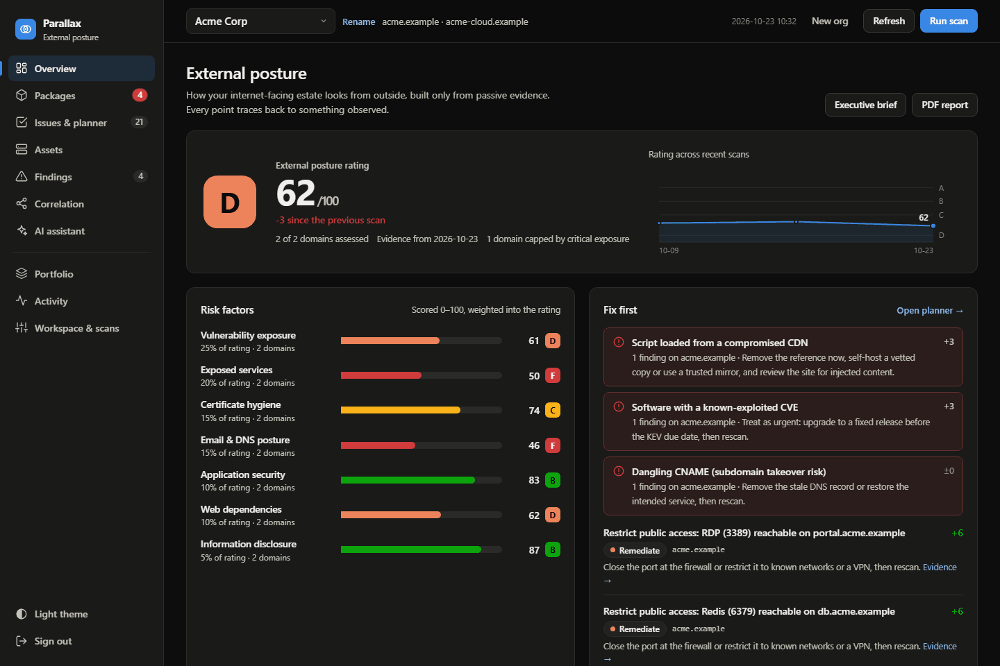
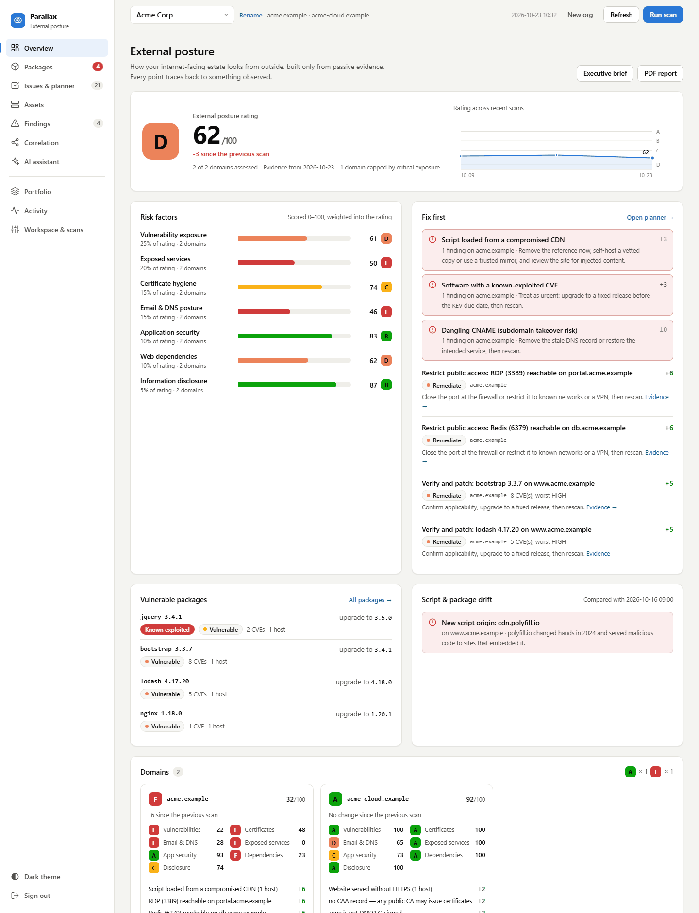
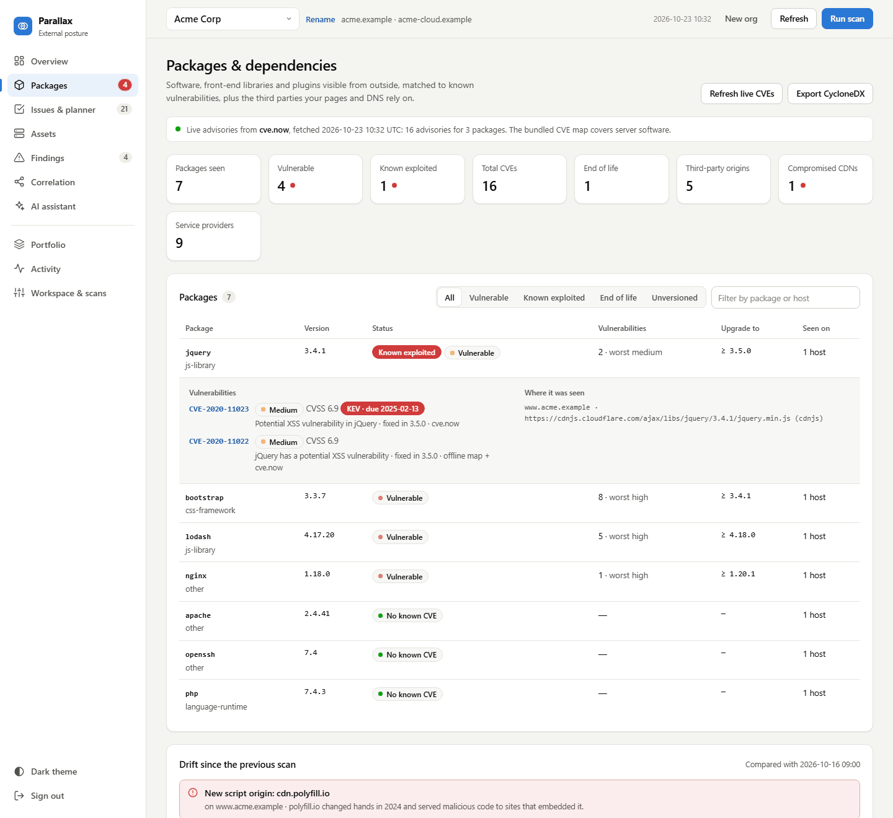
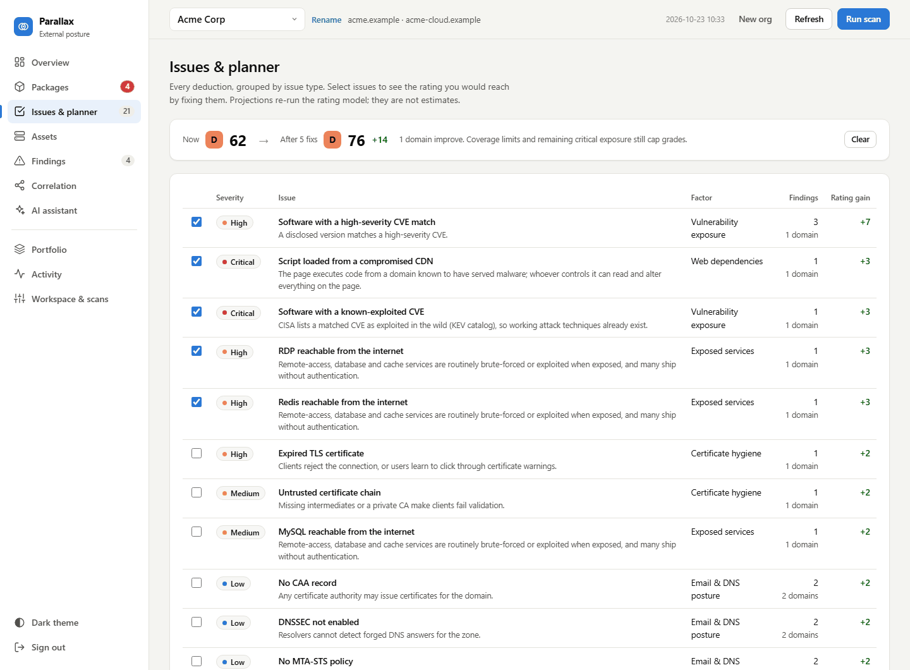
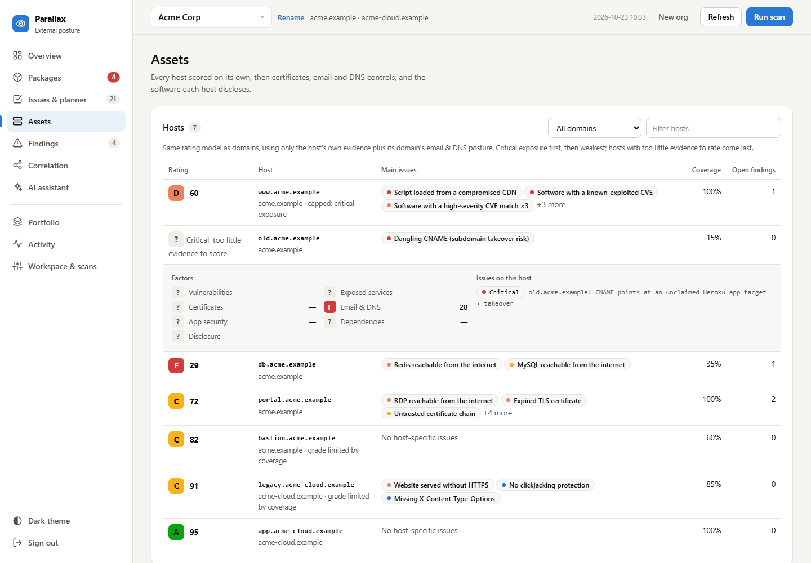
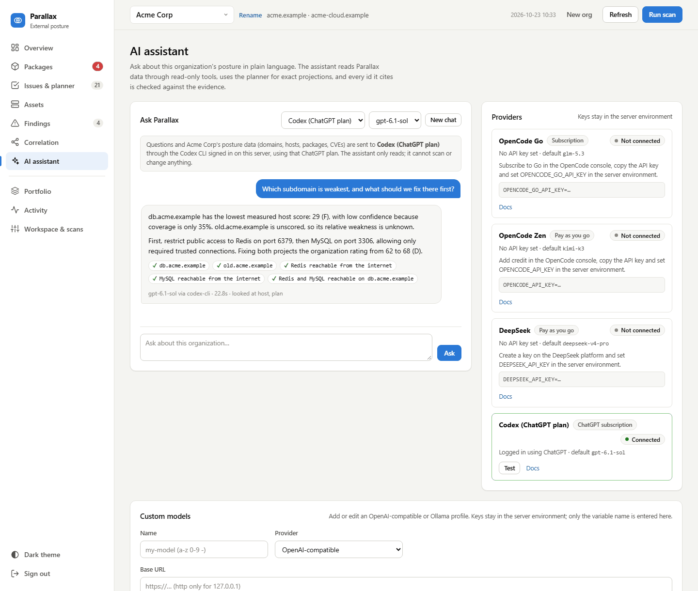
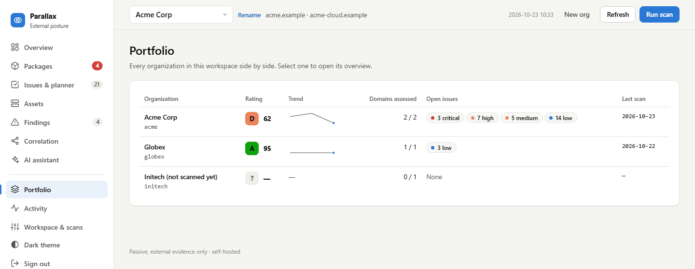

# Parallax — External Posture & Dependency Intelligence

**See your attack surface the way the internet does.** Parallax is a
self-hosted tool that rates the external security posture of the domains you
own and shows, in detail, which vulnerable packages and third-party
dependencies anyone can see from outside. It **scans domains passively**
(deterministic or AI-assisted), turns the evidence into an itemized **A–F
rating** with an exact what-if planner, inventories **packages, script origins
and service providers** with live CVE intel, **tracks findings** through a
mitigation lifecycle, builds a **correlation graph** (host ↔ IP ↔ CVE ↔ brand),
and exports executive reports and CycloneDX. All local, auth-gated, PII-masked,
and $0.

Built as a FastAPI backend and a single-file frontend (no build step, no
external assets, light and dark themes). It is **multi-tenant by org**:
register any workspace (a domain you own or are authorized to assess), scan
it, and compare organizations side by side.

> **Formerly CTI Radar.** Runtime paths (`~/.config/cti-radar`, `~/.local/share/cti-radar`),
> `CTI_*` environment variables and the systemd unit name are unchanged, so
> existing installs keep working.

> **Onboarding an agent or engineer?** Read [HANDOFF.md](HANDOFF.md) — current
> cycle state, the scanner traps that will bite you, and the open backlog.



> **Two backends.** The FastAPI app under `app/` has the full feature set,
> including everything Parallax adds: the posture rating, host ratings, the
> what-if planner, packages & dependencies, live CVE intel, the AI assistant
> and the portfolio. The native **Rust** server under `rust/` (Axum + Tokio,
> a single static binary that embeds this dashboard) serves the classic
> correlation, findings, scan and vuln-lookup APIs but has **not** been ported
> to the posture features yet; on it, those views report that the backend does
> not provide them. See [Python backend](#python-backend-parity-reference).

> **Intended use:** authorized security teams assessing **their own** external
> footprint. Scanning is **passive / non-intrusive by default** (certificate
> transparency — crt.name / crt.sh / certspotter / hackertarget — plus DNS
> resolution, HTTP header probe, a TCP connect scan of common service ports, and
> InternetDB enrichment). Active probing (Nuclei templates, OpenHack) is
> deny-by-default and gated behind `CTI_VULN_*` / `CTI_OPENHACK_*`
> authorization. Use it only on infrastructure you own or are explicitly
> authorized to test.

---

## Quick start (full feature set)

The posture features run on the Python backend. Keep scan data in a folder
outside the checkout; the tracked `data/orgs.json` is a public sample.

```bash
git clone https://github.com/bhanuharya/parallax.git && cd parallax
python3 -m venv .venv && .venv/bin/pip install -r requirements.txt
mkdir -p ~/.local/share/cti-radar

CTI_DATA_DIR=~/.local/share/cti-radar \
CTI_USER=admin CTI_PASSWORD='a-long-random-password' \
CTI_SCAN_TOKEN='another-long-random-string' \
.venv/bin/python app/main.py          # http://127.0.0.1:8084
```

1. Sign in, choose **New org**, and add domains you own or are authorized to
   assess.
2. **Run scan**. The overview fills with the rating, risk factors, hosts,
   packages and the fix-first list.
3. Optional: set `CTI_CVE_NOW=1` for live advisories (sends package names and
   versions only), and connect an AI provider for the assistant: an
   `OPENCODE_GO_API_KEY`, `OPENCODE_API_KEY` or `DEEPSEEK_API_KEY`, or
   `codex login --device-auth` to use a ChatGPT plan through Codex.

The [Screens](#screens) section shows each view with demo data.

---

## Features

- **Organization names** — use **Rename** beside the organization selector,
  or **Workspace & scans → Organization → Display name → Save name**.
  Names are saved across restarts and used in the selector, portfolio and
  reports. The organization id, domains and scan history are preserved.
  API clients can send `PATCH /api/orgs/{slug}` with `{"name":"New name"}`
  using the same authentication as other workspace changes.

- **Comparable rating history** — rating model v3 treats services as unknown
  for domains with no probe evidence and tracks which pages had asset capture.
  Trend lines break when observation coverage or the assessed domain population
  changes; portfolio sparklines show the most recent comparable segment.
  Older model scores remain in the ledger but are not compared to v3 scores.

- **Multi-org / workspaces** — register any org (slug-validated), per-org data stays
  in `data/orgs/<slug>/`.
- **Dual-mode scanning** — `fast` (deterministic, $0) or `ai` (after deterministic
  capture, an optional LLM triages only the interesting hosts into `AI-ASSESSED`
  findings, then re-grades existing findings' severity/impact). AI never fails a
  scan; it degrades to the deterministic result.
- **OpenHack active assessment (separate from passive CTI scans)** — the
  `/openhack-scan` endpoint is fail-closed behind a server-level operator gate,
  exact target allowlist, and time-bounded ROE.
- **Passive service discovery** — for each resolved host/IP the scanner performs a
  TCP connect scan of common service ports (ssh, rdp, mysql, …), surfacing exposed
  services without payloads or banner grabbing.
- **Six passive enumeration sources** — certificate transparency (crt.name /
  crt.sh / certspotter) plus hackertarget, **Wayback Machine CDX** and
  **AlienVault OTX passive DNS**, so hosts that never had a TLS certificate are
  still found. **Wildcard-DNS filtering** drops names that only echo a `*.` record.
- **Offline version→CVE matching** — software versions parsed from headers,
  titles and service banners (SSH/FTP/SMTP/MySQL) are matched against a vendored
  high-impact CVE map (`app/cve_data.json`, 33 products / 59 CVEs). Matches are
  tiered **CORRELATED** with an explicit verify caveat and confidence
  (LOW/MED) badges — deterministic, offline, $0. Optional **NVD 2.0
  enrichment** (`CTI_NVD_ENRICH=1`) adds official CVSS score/vector,
  disk-cached and fail-open.
- **Security-header findings** — missing HSTS/CSP/X-Frame-Options/
  X-Content-Type-Options on reachable hosts (HSTS/CSP only expected on HTTPS;
  auth surfaces bumped to MEDIUM).
- **New-exposure diffing** — every scan is diffed against the previous scan's
  baseline: newly resolved hosts and newly open service ports become
  CONFIRMED findings, so attack-surface growth is tracked over time. A
  dashboard quick-filter isolates them.
- **Certificate inventory** — every HTTPS host's certificate is captured via a
  stdlib handshake (no payload) and stored in scan meta, so healthy certs are
  browsable, not just broken ones. Records subject/issuer, notBefore/notAfter,
  days remaining, SAN list, key size, and three independent verdicts:
  hostname match (RFC 6125 exact/wildcard/IP-SAN), chain trust against the
  system store, and self-signed. Expired, **expiring within 30 days**
  (`CTI_CERT_EXPIRY_WARN_DAYS`), hostname-mismatched, self-signed and
  untrusted-chain certs each become deterministic findings. Served by
  `GET /api/certificates` and the dashboard **Certificates** panel.
- **Software inventory** — disclosed product/version pairs per host, joined
  with matched CVEs, served by `GET /api/software` and the dashboard
  **Software & CVEs** panel. The inventory re-runs the offline CVE map itself,
  so a vulnerable version is flagged even when no finding was synthesized for
  it. CVEs are attributed **per product**, not per host, so a page running
  WordPress + jQuery + Bootstrap shows each component's own CVEs.
- **Framework & CMS detection** — `app/tech_detect.py` identifies the
  application stack, not just the web server, using only evidence a normal
  visitor receives: the `<meta name="generator">` tag (WordPress/Drupal/Joomla
  with versions), version-bearing asset paths (`jquery-3.6.0.min.js`,
  `bootstrap-5.3.0.min.css`, `ng-version="17.0.0"`), framework headers
  (`X-AspNet-Version`, `X-Drupal-Cache`, `X-Nextjs-Cache`) and session cookie
  names (`laravel_session`, `csrftoken`, `PHPSESSID`). Versioned detections
  feed CVE matching; identity-only detections (e.g. Next.js with no version in
  the markup) are inventory-only and are **never** CVE-matched, because a
  product name without a version cannot be matched to an affected range. Each
  row carries a kind (`cms`, `js-framework`, `server-framework`, …) and a
  confidence, and the UI distinguishes "no version" from a version.
- **External posture rating** — a per-domain A–F rating over seven risk
  factors, each scored 0–100 on its own and weighted into the total:

  | Factor | Weight | Evidence |
  |---|---|---|
  | Vulnerability exposure | 25 | CVE-bearing software and packages, per product |
  | Exposed services | 20 | high-risk ports (RDP, SMB, databases, caches, Docker API) |
  | Certificate hygiene | 15 | expired, mismatched, untrusted, self-signed, expiring |
  | Email & DNS posture | 15 | the DNS posture score below, attributed per check |
  | Application security | 10 | HTTPS, HSTS, CSP, clickjacking, nosniff, cookie flags |
  | Web dependencies | 10 | compromised CDNs, end-of-life libraries, mixed content, unpinned or unverified CDN assets |
  | Information disclosure | 5 | versions in `Server`, `X-Powered-By`, `X-AspNet-Version`, generator tags |

  Every deduction is itemized (`{code, type, label, points, detail}`) and
  belongs to a catalogued **issue type** with severity, why it matters and how
  to fix it, so the number is reproducible rather than an opinion. Each card
  reports its **coverage** and confidence.

  The rules that keep the rating honest:
  - **Unknown is not good.** A factor with no data is excluded from the
    average (an outage must not read as a finding), but the resulting grade is
    capped, because partial evidence cannot support a top score. A card below
    30% coverage reports `?` rather than a number.
  - **Critical exposure caps the rating at 60.** A critical CVE match, a page
    loading a compromised CDN, or a subdomain open to takeover cannot be
    laundered into a B by clean hygiene elsewhere. CVEs on CISA's Known
    Exploited list rank first in every action list.
  - **No double counting.** A host is attributed to exactly one registered
    domain, and CVEs in front-end packages are scored once, in the
    vulnerability factor.
  - **Exact projections.** The "gain" shown for an issue is computed by
    re-running the model without it, so caps and budgets are honoured: fixing
    one of two critical CVEs gains nothing while the other still holds the cap.

  Served by `GET /api/posture` (`/api/scorecard` remains as an alias). Weights,
  deduction tables and the issue catalog live in `app/scorecard.py`.

- **Host (subdomain) ratings** — every observed host is scored by the same
  model as its domain, from its own evidence plus its domain's email & DNS
  posture (a dangling-CNAME takeover stays on the host it was found on).
  Hosts with critical exposure are listed first, then weakest score; hosts
  with too little evidence are marked unrated rather than given a number.
  Served by `GET /api/hosts` and the **Hosts** table in Assets.

- **Issues & planner** — every deduction grouped by issue type with the
  org-wide rating gain of fixing it. Select issues and `GET /api/posture/plan?fix=`
  returns the projected rating per domain and for the org, from the same
  snapshot and model. **Next moves** turns deductions into concrete steps;
  missing evidence gets an **Assess** action. Gains are projections under the
  current model, not promises.

- **Packages & dependencies (outside-in dependency checker)** — what a site
  depends on, as any visitor can see it, read from the homepage markup the
  scan already downloads (no extra requests for assets):
  - **Packages**: server software and frameworks from banners and markup,
    front-end libraries from every `<script>`/stylesheet (cdnjs, jsDelivr,
    unpkg, Google Hosted Libraries, code.jquery.com, BootstrapCDN, known
    library file names, WordPress `?ver=` assets), and WordPress plugins and
    themes. Each package version carries its matched CVEs with severity, CVSS,
    fixed version, CISA KEV status and source, plus the exact URL or header it
    was seen in, and end-of-life status (AngularJS, jQuery 1–2, Bootstrap ≤4,
    Vue 2).
  - **Third-party script origins** with Subresource Integrity coverage, and
    known-compromised CDN hosts (polyfill.io and related domains).
  - **Service providers** a domain relies on, from MX, NS, SPF includes,
    verification TXT records, CNAME targets and script origins.
  - **Drift**: a new third-party script origin, package or version on a page
    examined in both the previous and the current scan, which is the
    externally visible signature of script injection. First looks and pages
    that failed to load are never reported as drift.
  - **CycloneDX 1.5 export** of the observed components and vulnerabilities
    (`GET /api/dependencies/cyclonedx`), declared `incomplete` because an
    outside-in view is not an application SBOM.

  Served by `GET /api/dependencies`. Query strings are dropped from stored
  asset URLs (they can carry API keys).

- **Live CVE advisories (cve.now, opt-in)** — with `CTI_CVE_NOW=1`, each scan
  asks [cve.now](https://cve.now) (CVE List, GitHub advisories, OSV, NVD,
  EUVD, CISA KEV, EPSS and Exploit-DB merged; free, no API key) for
  vulnerabilities affecting the exact npm package versions it saw, and for
  CVSS and exploitation status of CVEs the bundled map matched on server
  software. Only package names, versions and CVE ids are sent, never domains
  or hosts. Results are captured into the scan snapshot, so ratings stay
  reproducible and page loads never call out; live CVSS overrides the bundled
  map where present. `POST /api/orgs/{slug}/live-cves` re-captures them for
  the current snapshot. Fail-open and disk-cached (`CTI_CVE_NOW_TTL`).

- **AI assistant** — ask about an organization in plain language ("What is
  the fastest path to a B?", "Which known-exploited packages do we run?").
  The model works through read-only tools over the same data the dashboard
  shows (rating, issues, the exact planner, packages, findings, history), and
  every CVE, host, package, finding or issue it cites is checked against the
  org's evidence; invented ids are flagged. It cannot scan or change
  anything. Supported providers appear once connected:

  | Provider | How to connect |
  |---|---|
  | OpenCode Go (subscription) | `OPENCODE_GO_API_KEY` |
  | OpenCode Zen (pay as you go) | `OPENCODE_API_KEY` |
  | DeepSeek | `DEEPSEEK_API_KEY` |
  | Codex with a ChatGPT plan | `codex login --device-auth` as the server user |

  Keys are read from the server environment and never sent to the browser.
  Codex runs read-only in an empty scratch directory, without your Codex
  config or this server's secrets. The selected provider receives the
  question and the org's posture data, as the page states before you ask.
  Routes: `GET /api/ai/providers`, `POST /api/ai/providers/{id}/test`,
  `POST /api/orgs/{slug}/assistant`.

- **Portfolio** — every registered organization side by side with its rating,
  trend and open issues by severity (`GET /api/portfolio`).

- **Score history and trend** — completed scans retain compact, versioned
  domain scores in the history ledger. Each domain is compared with the
  preceding scan only when observed hosts, versioned product identities,
  assessed DNS controls and coverage match; losing evidence is flagged as a
  coverage change, not credited as improvement. The trend line plots only
  scans scored under the current model version.

- **Executive brief** — download a printable HTML report from the overview,
  or use **PDF report**. Both include the rating, risk factor grades, top
  issues with their rating gain, the first ten actions and factor-level
  evidence before the finding detail. HTML needs no browser installation on
  the server; PDF export falls back to HTML if Chromium is unavailable.
  `GET /api/orgs/{slug}/report.html` uses the same authentication, tenant
  checks, masking, and size limits as the PDF route.

  **Scope, stated plainly:** this is an *external*, evidence-based rating
  built from what a passive scan can observe. It is not equivalent to a
  commercial security-rating service: there is no internal/agent telemetry,
  no peer benchmarking dataset, no questionnaire-based vendor assessment, and
  no compliance framework mapping. See
  [What this rating is and is not](#what-this-rating-is-and-is-not).
- **Email & DNS posture** — per registered domain, a deterministic supply-chain
  posture check over public DNS: **SPF** (presence, `+all`/`~all` qualifier,
  RFC 7208 lookup budget), **DMARC** (policy none/quarantine/reject, `pct`,
  reporting), **DKIM** (common-selector probe; null keys with empty `p=`
  distinguished from usable keys), **DNSSEC** (DNSKEY + DS presence — reported
  as chain-present, never as validated), **CAA** (authorised issuers), and
  **MTA-STS**. Plus **dangling-CNAME takeover checks**: a subdomain pointing
  at an unclaimed third-party service (S3, GitHub Pages, Heroku, Azure, …)
  becomes a HIGH finding. Every check degrades to *unknown* — never a finding
  — when a lookup fails, and an absent record is worded as a posture gap, not
  a compromise. Served by `GET /api/dns-posture` and the dashboard **Email &
  DNS posture** panel with a per-domain A–F grade; disable with
  `CTI_DNS_POSTURE=0`.
- **Correlation engine** — derives NEW findings from existing ones: CVE fleet-spread,
  IP co-residency, InternetDB source-backed exposure.
- **Finding detail** — `found_date`, tier (CONFIRMED / CORRELATED / AI / CLEAN),
  reproduction steps, evidence snapshot, **PII masking**, NVD CVE links, Shodan /
  InternetDB source links.
- **Status lifecycle** — per-finding `OPEN / IN_PROGRESS / MITIGATED /
  ACCEPTED_RISK` with an audit `status_history[]` and per-org append-only **scan
  ledger** (new / resolved / changed diffs).
- **PDF report** — per-org printable report (title + severity summary + one section
  per finding) rendered via headless Chromium, with HTML fallback. Auth-gated,
  concurrency-limited, PII-masked.
- **Filter & sort** — by severity, recency, status, and a findings view tab
  (All / Detected / Correlated).
- **Bounded jobs** — scan, recheck, and correlation jobs are serialized per org.
  Terminal states (done/failed) are retained so status polling works reliably.
- **Responsive + mobile** — dark theme works on phones; graph is touch-friendly.

- **Vulnerability lookup (host-based)** — **Workspace & scans → Vulnerability
  lookup** (org-wide) or **vuln: this host** in any finding reuses stored
  fingerprints: offline CVE map plus version/header/TLS/login audit. The
  optional **Nuclei engine** runs community templates over in-scope URLs behind
  the fail-closed `CTI_VULN_*` gate (details below).
- **Model config without JSON** — **AI assistant → Custom models**
  (add/edit/test/delete, generic fields), single-profile `CTI_AI_*` env, or
  `python -m app.ai_setup --wizard`. All additive: existing profiles and the
  default are preserved; keys stay in server env. The AI scan option names its
  exact blocker (e.g. which key env is missing) instead of failing silently.
- **Bounded jobs** — scan, recheck, correlate, vuln-scan, AI-grade, and
  OpenHack jobs are serialized per org with a global active-job cap; terminal
  states (done/failed) are retained so status polling works reliably.

## Backend architecture (Rust)

```
Axum     HTTP router, typed handlers, JSON, security-header middleware
Tokio    concurrent DNS / HTTP / TCP / TLS / background-job I/O
Rayon    CPU-bound normalization, masking, graph preparation
Rustls   TLS support with no OpenSSL runtime dependency
```

Security invariants enforced in code:

- Auth on every route (session cookie or `X-CTI-Token`, constant-time compare).
- Slug regex `^[a-z0-9-]{1,32}$` before any filesystem use.
- PII masking on every read path; SSRF/DNS-rebinding guards on scanner and AI
  URLs.
- Atomic `0600`/`0700` writes; security headers on every response; per-org
  write locks.
- OpenHack and Nuclei are **fail-closed**: gate checks run before any binary
  lookup, process creation, or network-capable work.

## Project structure

```
rust/                  native backend (canonical)
  Cargo.toml           dependencies (rustls TLS, no OpenSSL dep)
  src/
    main.rs            serve + bind policy (refuses 0.0.0.0/::)
    lib.rs             module tree, router, embedded dashboard
    config.rs          env config (mirrors .env.example exactly)
    auth.rs            session cookie + X-CTI-Token (constant-time)
    handlers.rs        read endpoints
    handlers_mut.rs    mutation endpoints (register/scan/status/...)
    jobs.rs            per-org job serialization + global cap + TTL
    correlation.rs     registry, PII mask, lifecycle, graph/summary/fleet/ips
    scanner.rs         passive recon: enum/DNS/HTTP/TCP/TLS/InternetDB + findings
    cve_match.rs       offline version->CVE matching + NVD enrichment
    vuln_scan.rs       host vuln lookup + gated Nuclei runner (consolidated)
    vuln_handlers.rs   vuln-scan + engines HTTP handlers
    ai.rs              AI providers (ollama + openai-compatible), SSRF-validated
    openhack.rs        active-assessment wrapper (fail-closed)
    report.rs          PDF (Chromium) + HTML fallback
    net.rs / logs.rs / error.rs
  tests/               integration suites (API parity, vuln-scan security)
  PORT.md              full Python→Rust port spec (module map + API surface)
app/                   Python (FastAPI) parity implementation
  main.py              FastAPI server (legacy parity)
  vuln_scan.py / nuclei_scan.py   Python-side vuln lookup + Nuclei provider
  dashboard.html       single-file frontend (embedded into the Rust binary)
  static/              vendored vis-network (no CDN)
tests/                 Python test suite (parity reference)
bench/                 benchmark harness (API latency, scan, CPU/RSS)
data/                  state: orgs.json + per-org findings/history (gitignored)
```

## Requirements

Python backend (full feature set):

- **Python 3.11+**
- **fastapi** + **uvicorn** + **dnspython** (see `requirements.txt`).
  dnspython powers the SPF/DMARC/DKIM/DNSSEC/CAA lookups — the stdlib resolver
  only exposes A/AAAA. It is imported lazily: without it, the DNS posture
  stage degrades to "unknown" and every other scan stage still works.

Rust backend (classic APIs):

- **Rust stable toolchain** to build; the resulting binary has no runtime
  language dependencies.
- **One process on one host.** State is JSON files guarded by process-local
  locks with in-memory sessions/jobs — multiple workers or two instances
  sharing a data directory can lose updates. See
  [DEPLOYMENT.md](DEPLOYMENT.md) for the supported shape, hardened systemd
  unit, and reverse-proxy/trusted-proxy notes.
- **curl** (used by the passive scanner / fingerprinting).
- **Optional — headless Chromium** for PDF export. If absent, the report
  falls back to a printable HTML download.

## Build & run

```bash
cd rust
cargo build --release

CTI_USER=admin \
CTI_PASSWORD=change-me-to-a-long-random-string-1 \
CTI_SCAN_TOKEN=change-me-to-a-long-random-string-2 \
CTI_DATA_DIR=/path/to/data \
CTI_HOST=127.0.0.1 CTI_PORT=8085 \
./target/release/cti-radar
```

The server binds `127.0.0.1` by default and **refuses** `0.0.0.0`/`::` — put a
reverse proxy in front for TLS. All state lives under `CTI_DATA_DIR`.

### Environment variables

| Variable | Purpose |
| --- | --- |
| `CTI_USER` / `CTI_PASSWORD` | dashboard login |
| `CTI_SCAN_TOKEN` | machine token (`X-CTI-Token`) |
| `CTI_DATA_DIR` / `CTI_HOST` / `CTI_PORT` | state dir and bind address |
| `CTI_AI_PROFILE_NAME/PROVIDER/BASE_URL/MODEL/API_KEY_ENV` | single AI profile override |
| `CTI_AI_CONFIG` / `CTI_AI_CONFIG_FILE` | multi-profile AI config (file shape: `data/ai_config.example.json`) |
| `CTI_VULN_ACTIVE` / `CTI_VULN_ISOLATED` / `CTI_VULN_ALLOWED_DOMAINS` / `CTI_VULN_ROE_EXPIRES` | active vuln-lookup gate (all four required, deny-by-default) |
| `CTI_NUCLEI_BIN` / `CTI_NUCLEI_TEMPLATES` / `CTI_NUCLEI_SEVERITY` / `CTI_NUCLEI_TAGS` / `CTI_NUCLEI_EXCLUDE_TAGS` / `CTI_NUCLEI_RATE_LIMIT` / `CTI_NUCLEI_TIMEOUT` / `CTI_NUCLEI_INTERACTSH` | Nuclei engine tuning (see `.env.example`) |
| `CTI_OPENHACK_ACTIVE` / `CTI_OPENHACK_ISOLATED` / `CTI_OPENHACK_ALLOWED_DOMAINS` / `CTI_OPENHACK_ROE_EXPIRES` | OpenHack active-assessment gate |
| `CTI_CVE_NOW` / `CTI_CVE_NOW_TTL` / `CTI_CVE_NOW_MAX_PACKAGES` / `CTI_CVE_NOW_MAX_LOOKUPS` | live cve.now advisories, opt-in (Python backend) |
| `OPENCODE_GO_API_KEY` / `OPENCODE_API_KEY` / `DEEPSEEK_API_KEY` / `CTI_CODEX_BIN` | AI assistant providers; Codex uses `codex login` (Python backend) |
| `CTI_ASSET_CAP` | scripts/stylesheets kept per host for the dependency inventory (Python backend) |

## API surface

```
GET  /api/graph · /api/summary · /api/fleet · /api/ips · /api/findings
GET  /api/dashboard · /api/orgs · /api/admin/logs · /api/findings/{id}
GET  /api/orgs/{slug} · /{slug}/dashboard · /{slug}/history · /{slug}/report.pdf
POST /api/login · /api/logout

POST /api/orgs/register
POST /api/orgs/{slug}/scan · /{slug}/recheck · /{slug}/correlate · /{slug}/ai-grade
GET  /api/orgs/{slug}/scan/{job_id} · /recheck/{job_id} · /correlate/{job_id} · /ai-grade/{job_id}
POST /api/orgs/{slug}/domains · /{slug}/findings/{id}/status · /{slug}/findings/{id}/comment

GET  /api/vuln/engines                        passive/nuclei availability
POST /api/orgs/{slug}/vuln-scan               vuln lookup queue (passive default)
GET  /api/orgs/{slug}/vuln-scan/{job_id}      vuln lookup status

GET  /api/ai/capabilities                     AI readiness + blockers
GET/POST /api/orgs/{slug}/ai_profile          per-org AI profile (read/set)

POST /api/orgs/{slug}/openhack-config · /{slug}/openhack-scan   (gated)

Python backend only (Parallax posture features):

GET  /api/posture (alias /api/scorecard)      per-domain rating, factors, issues
GET  /api/posture/plan?fix=type,…             projected rating with issues fixed
GET  /api/hosts                               per-host ratings, critical/weakest first
GET  /api/dependencies · /api/dependencies/cyclonedx   packages, origins, providers, drift
GET  /api/certificates · /api/software · /api/dns-posture   asset inventories
GET  /api/portfolio                           every org's rating side by side
GET  /api/ai/providers · POST /api/ai/providers/{id}/test   AI providers
POST /api/orgs/{slug}/assistant               read-only AI analyst
POST /api/orgs/{slug}/live-cves               opt-in cve.now refresh
PATCH /api/orgs/{slug}                        rename an organization
```

All routes are auth-gated; login is rate-limited and sessions expire. The
multi-profile AI CRUD (`/api/ai/profiles`, `/api/ai/default`, `/api/ai/test`)
currently exists in the Python parity implementation only — the Rust backend
covers single-profile env config and the per-org `ai_profile` endpoint.

## Vuln lookup (host-based, passive by default)

`Vuln scan` (org-wide, next to Correlate) or `vuln: this host` on any finding
reuses stored fingerprints — no re-enumeration, no exploits:

- `cve` — offline `cve_data.json` version→CVE match (`CORRELATED`, capped
  HIGH).
- `version` / `headers` / `tls` / `login` — config audit from captured data
  (version disclosure LOW, missing HSTS/CSP framing LOW/MEDIUM, expired cert
  MEDIUM).
- Targets must belong to the org (stored hosts or subdomains of registered
  domains); out-of-scope targets are rejected before any network. Genuinely
  new findings persist deduplicated (`source: vuln-scan`).
- `engine: "passive"` is local-only: it evaluates already stored fingerprints
  without fresh DNS, HTTP, TLS, or NVD requests.

### Nuclei engine (opt-in, fail-closed)

`engine: "nuclei"` is active and **never runs** unless all checks pass before
binary lookup or process creation:

- `CTI_VULN_ACTIVE=1` and `CTI_VULN_ISOLATED=1`;
- nonempty `CTI_VULN_ALLOWED_DOMAINS` containing every registered domain
  exactly (DNS names only; no URLs, paths, ports, wildcards, or IPs); and
- a future, timezone-aware RFC3339 `CTI_VULN_ROE_EXPIRES`.

The gate is re-checked at queue time **and** again inside the background
runner, so an expired ROE aborts mid-flight jobs. Hardened defaults: severity
`critical,high,medium`, rate limit 20/s (clamped 1–150), 300 s budget (clamped
60–1200), output bounded to 10 MiB / 500 events, `dos`/`fuzz`/`intrusive`
templates always excluded (`dos`/`fuzz` cannot be re-enabled), Interactsh/OAST
off unless `CTI_NUCLEI_INTERACTSH=1` exactly, child env reduced to a fixed
allowlist, private per-run workdir removed afterwards, and runner stderr
captured for failure diagnostics.

Nuclei inputs are canonical registered hostnames — stored fingerprint URLs can
supply only a matching scheme and a common web port. Findings are
`source: nuclei`, `NUCLEI-MATCHED`, severity capped at HIGH, identity
`nuclei|host|template|path`, validated CVE IDs only. Template matches are
evidence, not exploit proof.

## What this rating is and is not

The rating is often compared to commercial security-rating products. The comparison is useful for framing
and misleading if taken literally, so the boundary is stated here explicitly.

**What it does, using only externally observable evidence:**

| Capability | Status here |
|---|---|
| Security rating per domain (A–F) | Yes: itemized, reproducible, seven weighted factors |
| Risk prioritization | Yes: issues sort by exact rating gain; known-exploited CVEs rank first |
| Continuous monitoring | Partly: score history, trend and script/package drift per scan; scheduling is up to you |
| Supply-chain / third-party surface | Yes: packages, script origins, service providers, drift |
| What-if planning | Yes: exact projected rating for any set of issue types |
| Executive reporting | Yes: HTML/PDF brief with factor grades, top issues and actions |

**What it explicitly does not do:**

- **No internal telemetry.** Everything derives from a passive external scan.
  Endpoint agents, EDR, SIEM correlation and internal asset inventory are out
  of scope by design — this tool never sees inside your network.
- **No peer benchmarking.** Commercially meaningful ratings are calibrated
  against an industry dataset of millions of companies. This rating is
  *absolute and self-referential*: it tells you which of your own domains is
  worst and whether it improved. Comparing your A to another company's A is
  not meaningful, because both are scored against the same fixed rubric rather
  than a population distribution.
- **No questionnaire-based vendor assessment.** TPRM in the commercial sense
  means scoring a *third party* on self-attested controls, contracts and
  certifications. Here, "vendor risk" means only the externally visible parts
  of your own supply chain (dangling CNAMEs to third-party services, disclosed
  framework versions).
- **No compliance framework mapping.** There is no SOC 2 / ISO 27001 / PCI
  DSS control mapping. Posture checks align with good practice, but this
  produces no audit evidence.
- **No incident response, threat feeds or real-time alerting.** Threat intel is
  limited to vulnerability advisories: the bundled CVE map, plus CVSS and
  CISA KEV status from the opt-in cve.now source.

The honest one-line framing: **it is a defensible, explainable external
security rating for domains you own — not a market-calibrated industry score.**

## OpenHack active-assessment authorization

OpenHack is an **active external assessment**, separate from the passive CTI
scanner. It stays disabled unless all `CTI_OPENHACK_*` controls are set
(authorization flag, isolation flag, exact allowlist, unexpired ROE) — see
`.env.example` and [DEPLOYMENT.md](DEPLOYMENT.md). No exploit payloads; do not
enable it without written, time-bounded authorization.

## AI-assisted scanning (mode=ai)

Deterministic capture is the source of truth; the LLM is an optional
interpretive pass that adds vulnerability-context findings on top. Configure
profiles three ways — they merge additively and secrets are referenced by
env-var name only:

1. Dashboard **models** section (add/edit/test/delete, generic fields),
2. `CTI_AI_*` env vars (single profile), or
3. `python -m app.ai_setup --wizard` (file shape: `data/ai_config.example.json`).

Without AI config, `mode=ai` scans safely fall back to deterministic `fast`.
See `rust/PORT.md` for the prompt/concurrency/PII-mask details of the ported
implementation.

## Tests

```bash
cd rust && cargo test          # 63 tests: 27 unit + 18 API-parity + 18 vuln-scan
python -m pytest tests/ -q     # 221 tests (Python parity reference)
```

352 tests covering: tenant authentication, unknown org rejection, graph XSS
prevention, PDF PII masking, job state retention, provider URL SSRF validation,
session cookie security, CSP enforcement, registration limits, the
cheap-model AI triage flow (pre-filter, compact prompt, classifier parsing,
template expansion, and self-repair retry), AI grading with exposure
verification (`still_open` read of the latest probe data), probe-evidence
refresh on existing findings, deterministic login-portal / version-disclosure
findings, the Wayback/OTX enum sources + wildcard-DNS filtering, the offline
version→CVE map (comparator edges, alias normalization, banner-derived
versions, no-correlation-amplification) + optional NVD enrichment
(cache, fail-open), security-header findings, baseline-diff new-exposure
sequencing, resolver-pool + InternetDB-cache behavior, evidence-based AI
prompt enrichment (CVE candidates, missing-header signals, sanitizer
neutralization), and the asset-inventory layer (certificate hostname matching
RFC 6125 exact/wildcard/IP-SAN, expiry and chain and name-mismatch findings,
inventory ordering and capping, software rows joined with CVEs both from the
map and from findings, plus the authenticated `/api/certificates` and
`/api/software` endpoints), and the DNS posture layer (SPF qualifier and
RFC 7208 lookup-budget scoring, DMARC policy/pct/reporting, null-vs-usable
DKIM keys, DNSSEC DNSKEY/DS presence, CAA issuer parsing, MTA-STS, takeover
provider matching plus dangling-target classification, unknown-vs-missing
semantics so a resolver outage never becomes a finding, deterministic
grading, and dedup by identity_key across rescans), and the framework-detection
layer (generator / asset-path / header / cookie signatures, version extraction
and validation, identity-only detections excluded from CVE matching, per-product
CVE attribution, plus the HTTP/1.1-vs-HTTP/2 curl response split that governs
whether any body analysis runs at all), and the external posture rating (weighted
factors, itemized deductions, per-product CVE attribution, unknown-vs-assessed
pillar handling, coverage-based grade capping, the critical-CVE cap, monotonic
grading so a card cannot be laundered by clean hygiene elsewhere, single-domain
host attribution to prevent double counting, and header/card grade
consistency).

Rust coverage includes: gate fail-closed ordering (no binary lookup before
authorization), scope rejection of cached external hosts, child-env
allowlisting, output caps, exit-code semantics, JSONL event mapping (CVE
validation, severity cap, out-of-scope/IP drops), argv safety, web-port
allowlisting, job routing/auth, and API parity with the Python envelopes.

## Benchmarking

```bash
bash bench/bench.sh 5 api
bash bench/bench.sh 3 scan
python3 bench/compare.py bench/results/<timestamp>
```

Use one data directory and one fixed workload for every measured run; keep
network-heavy scan timing separate from local API timing.

## Python backend (parity reference)

The FastAPI implementation under `app/` is the port specification's source of
truth for the Rust backend, and currently the only backend with the Parallax
posture features (ratings, hosts, planner, packages & dependencies, live CVEs,
AI assistant, portfolio):

```bash
python3 -m venv .venv && .venv/bin/pip install -r requirements.txt
.venv/bin/python -m uvicorn app.main:app --host 127.0.0.1 --port 8084 --no-server-header
```

For the classic APIs it mirrors the Rust API surface (same envelopes, codes,
and job lifecycle) and is covered by the `tests/` suite. The Parallax posture
features exist only here so far; porting them to Rust is open work. New
backend work should target the Rust implementation where it can;
`rust/PORT.md` documents the module map and API contract between the two.

## Screens

All screenshots use a fictional demo workspace (`acme.example`).

**Overview**: the rating with its trend, the seven risk factors, what to fix
first with the exact rating gain, vulnerable packages, script drift, and
every domain.



**Packages & dependencies**: a known-exploited jQuery with its CISA KEV due
date, fixed version, and the exact asset URL it was seen in; third-party
script origins and a drift alert for a newly added compromised CDN.



**Issues & planner**: select issue types to see the projected rating,
computed by re-running the model.



**Hosts**: every subdomain scored on its own evidence, critical exposure
first.



**AI assistant**: answers from read-only tools, with every cited id checked
against the evidence.



**Portfolio**: every organization side by side.



## License & use

Self-hosted, auth-gated, PII-masked. Scan only what you own or are explicitly
authorized to test — passive by default, active only behind written,
time-bounded ROE gates.
